# Examples

Every operation, on networks small enough to check by eye. Each example is one of the
conformance cases in the `conformance` directory of the repository: a data file giving an
input, parameters and the expected result, which the tests run. The figures and this page
are drawn from those files by `docs/make_examples.py`, so they cannot drift apart.

How to read a figure:

- The input is on the left and the expected result on the right, at the same scale. The
  call is written underneath.
- A dot is a node, with its id beside it. A ring is a node that the operation created.
- A line is an edge, with its id in a box and an arrow showing its direction, from
  `from_id` to `to_id`. Each edge in a panel has its own colour, so the pieces of a split
  edge can be told apart. Colours do not carry over from input to result: follow the ids.
  An edge that lies along another is dashed, so that both show.
- Attributes are not drawn. Where a case has them, they are in tables under the figure.

## Creating a network

From lines, or points and lines, to nodes and edges that refer to each other.

### `from_edges`

#### Three lines that meet

A node is made at each distinct end point, numbered in order of first appearance. Lines whose ends are at exactly the same place share a node.

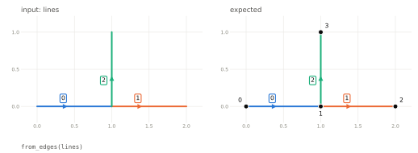

Case file: `conformance/operations/from_edges/three-lines.json`

#### Ends that nearly meet

Without a tolerance, ends are shared only if they are exactly equal, so these two lines are not connected.

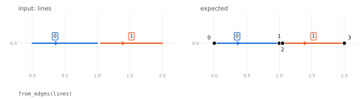

Case file: `conformance/operations/from_edges/near-ends-stay-apart.json`

#### Ends that nearly meet, with a tolerance

Ends within the tolerance become one node at their centroid, which keeps the id of the first. The same as merge_nodes afterwards.

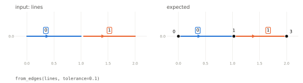

Case file: `conformance/operations/from_edges/tolerance.json`

#### A line in two parts

A MultiLineString becomes one edge for each part, in place and in order. Each part copies the attributes.

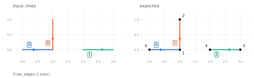

Input lines:

| row | name |
| --- | --- |
| 0 | A1 |
| 1 | B2 |

Expected edges:

| id | name |
| --- | --- |
| 0 | A1 |
| 1 | A1 |
| 2 | B2 |

Case file: `conformance/operations/from_edges/multilinestring.json`

#### Ids supplied as integers

A column named id that holds unique non-negative integers is used as the edge ids.

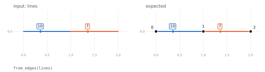

Case file: `conformance/operations/from_edges/integer-ids.json`

#### Ids supplied as text

Ids that are not non-negative integers are kept as an attribute, id_original, and integer ids are generated.

Expected edges:

| id | id_original |
| --- | --- |
| 0 | a |
| 1 | b |

Case file: `conformance/operations/from_edges/text-ids.json`

#### Ids from a named column

edge_id names the column to use as ids. It is used directly because it holds unique non-negative integers.

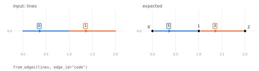

Input lines:

| row | code |
| --- | --- |
| 0 | 5 |
| 1 | 3 |

Case file: `conformance/operations/from_edges/id-column.json`

#### Unusable geometries, dropped

A line of no length, an empty line and a missing geometry cannot be edges. With invalid="drop" they are left out; the edges that remain are numbered from 0.

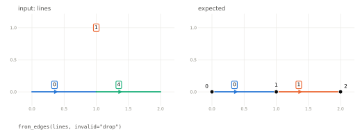

Input lines:

| row | name |
| --- | --- |
| 0 | good |
| 1 | no length |
| 2 | empty |
| 3 | missing |
| 4 | also good |

Expected edges:

| id | name |
| --- | --- |
| 0 | good |
| 1 | also good |

Case file: `conformance/operations/from_edges/invalid-dropped.json`

#### Unusable geometries, refused

By default a geometry that cannot be an edge is an error.

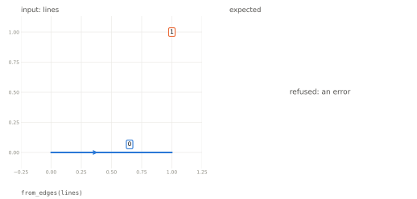

Case file: `conformance/operations/from_edges/invalid-refused.json`

#### A line that ends where it starts

A closed line becomes a self-loop: one node, and an edge from it to itself.

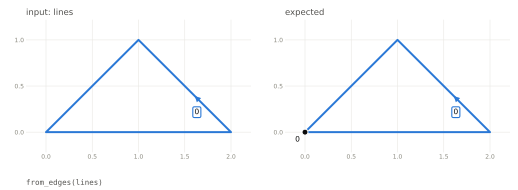

Case file: `conformance/operations/from_edges/closed-line.json`

#### Lines with Z coordinates

Z coordinates are dropped.

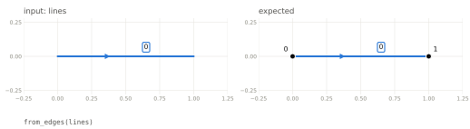

Case file: `conformance/operations/from_edges/z-dropped.json`

#### No lines

No lines give an empty network.

Case file: `conformance/operations/from_edges/empty.json`

### `from_nodes_and_edges`

#### Line ends attached to nearby nodes

Each line end is attached to the nearest node within the tolerance and moved exactly onto it: nodes are anchors. An end with no node in reach gets a new node.

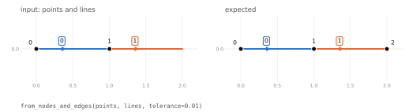

Input points:

| row | name |
| --- | --- |
| 0 | A |
| 1 | B |

Expected nodes:

| id | name |
| --- | --- |
| 0 | A |
| 1 | B |
| 2 |  |

Case file: `conformance/operations/from_nodes_and_edges/attach-within-tolerance.json`

#### A node out of reach

A node further than the tolerance from every line end is kept, unattached. Both ends get new nodes.

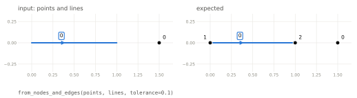

Case file: `conformance/operations/from_nodes_and_edges/far-node-left-alone.json`

#### Two nodes in reach of one end

An end with more than one node in reach is attached to the nearest.

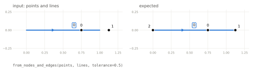

Case file: `conformance/operations/from_nodes_and_edges/nearest-node.json`

#### No tolerance

With no tolerance an end is attached only to a node at exactly the same place.

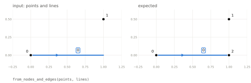

Case file: `conformance/operations/from_nodes_and_edges/exact.json`

#### Node ids supplied

Integer node ids are kept, and new nodes are numbered above the highest.

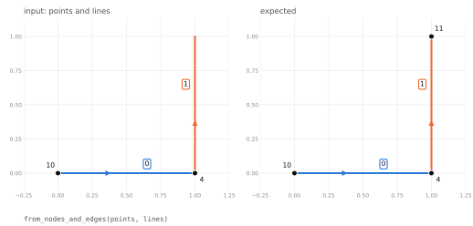

Case file: `conformance/operations/from_nodes_and_edges/node-ids.json`

#### A line shorter than the tolerance

Both ends of the short line are attached to the same node, which leaves it no length. With invalid="drop" it is left out.

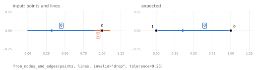

Case file: `conformance/operations/from_nodes_and_edges/collapsed-edge-dropped.json`

### `from_topology`

#### Tables that refer to each other by text ids

Ids are converted to integers in order of the nodes table. The originals are kept as id_original, from_id_original and to_id_original.

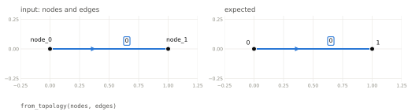

Expected nodes:

| id | id_original |
| --- | --- |
| 0 | node_0 |
| 1 | node_1 |

Expected edges:

| id | from_id_original | to_id_original |
| --- | --- | --- |
| 0 | node_0 | node_1 |

Case file: `conformance/operations/from_topology/text-ids.json`

#### Tables that refer to each other by integer ids

Non-negative integer ids are used as they are. Edges have no ids here, so they are numbered from 0.

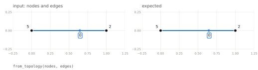

Case file: `conformance/operations/from_topology/integer-ids.json`

#### An edge end slightly off its node

Each edge end within the tolerance of its node is moved exactly onto it.

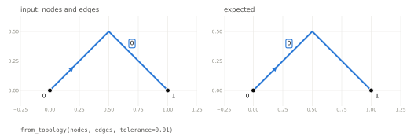

Case file: `conformance/operations/from_topology/ends-moved-onto-nodes.json`

#### An edge end far from its node

An edge end further than the tolerance from the node it names is an error.

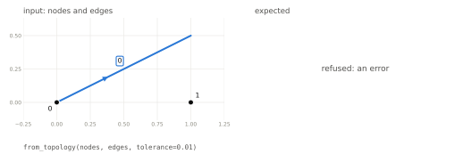

Case file: `conformance/operations/from_topology/end-too-far.json`

## Matchers

Matchers find things and change nothing. Each figure shows the network with the matches marked, and the table of matches is below it.

### `match_nodes`

#### One pair within tolerance

Nodes 1 and 2 are exactly the tolerance apart, which counts as within it. Each pair is reported once, with the node that comes first in the nodes table as node_a.

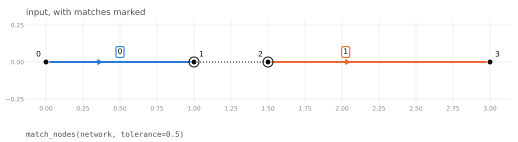

| node_a | node_b | distance |
| --- | --- | --- |
| 1 | 2 | 0.5 |

Case file: `conformance/operations/match_nodes/pair.json`

#### Three nodes in a row

Neighbours are matched, but the two outer nodes are further apart than the tolerance and are not. Pairs are sorted by node_a, then node_b.

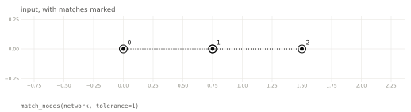

| node_a | node_b | distance |
| --- | --- | --- |
| 0 | 1 | 0.75 |
| 1 | 2 | 0.75 |

Case file: `conformance/operations/match_nodes/three-in-a-row.json`

#### Two nodes at the same place

With a tolerance of 0 only nodes at exactly the same place match.

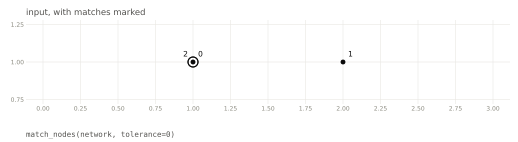

| node_a | node_b | distance |
| --- | --- | --- |
| 0 | 2 | 0 |

Case file: `conformance/operations/match_nodes/same-place.json`

### `match_nodes_to_edges`

#### Nodes are not matched to their own edges, or to the ends of others

Every node here is within tolerance of some edge, but only node 4 is near the middle of an edge it is not an end of. Node 2 is nearest to the very end of edge 1, so it is near a node and not near the edge.

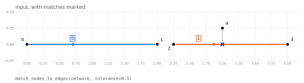

| node | edge | measure | x | y | distance |
| --- | --- | --- | --- | --- | --- |
| 4 | 1 | 0.75 | 3 | 0 | 0.25 |

Case file: `conformance/operations/match_nodes_to_edges/own-edges-and-ends.json`

#### Nearest edge to each chosen node

With how="nearest" each node chosen by the nodes mask gets one match, to its nearest edge, however far. Here the nearest place is the end of the edge, which is reported in this mode.

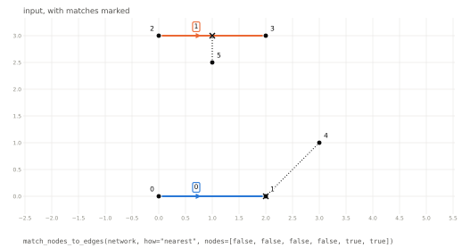

| node | edge | measure | x | y | distance |
| --- | --- | --- | --- | --- | --- |
| 4 | 0 | 2 | 2 | 0 | 1.41421 |
| 5 | 1 | 1 | 1 | 3 | 0.5 |

Case file: `conformance/operations/match_nodes_to_edges/nearest.json`

#### Nearest edge, within a distance

With a tolerance as well, a node with no edge that near has no match.

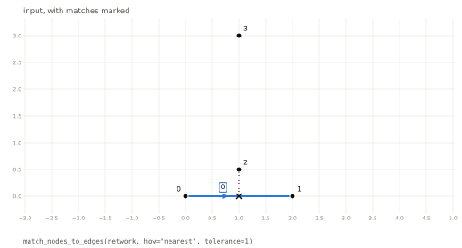

| node | edge | measure | x | y | distance |
| --- | --- | --- | --- | --- | --- |
| 2 | 0 | 1 | 1 | 0 | 0.5 |

Case file: `conformance/operations/match_nodes_to_edges/nearest-within.json`

#### Measure along an edge with a corner

The measure is the distance along the line from its start, round the corner: 2 along the first segment and 1 up the second.

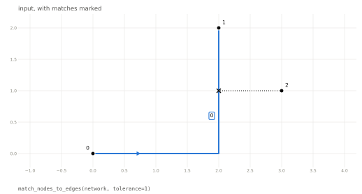

| node | edge | measure | x | y | distance |
| --- | --- | --- | --- | --- | --- |
| 2 | 0 | 3 | 2 | 1 | 1 |

Case file: `conformance/operations/match_nodes_to_edges/measure-along-a-bent-edge.json`

#### A node near two edges

With how="all" a node is matched to every edge within tolerance, nearest first.

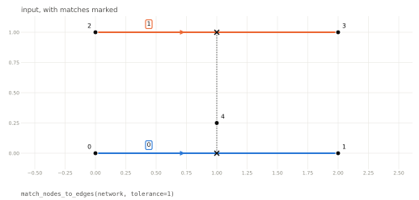

| node | edge | measure | x | y | distance |
| --- | --- | --- | --- | --- | --- |
| 4 | 0 | 1 | 1 | 0 | 0.25 |
| 4 | 1 | 1 | 1 | 1 | 0.75 |

Case file: `conformance/operations/match_nodes_to_edges/two-edges.json`

### `find_crossings`

#### Two edges that cross

One crossing, with the distance along each edge and the place.

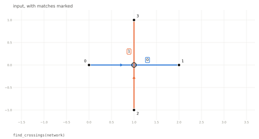

| edge_a | measure_a | edge_b | measure_b | x | y |
| --- | --- | --- | --- | --- | --- |
| 0 | 1 | 1 | 1 | 1 | 0 |

Case file: `conformance/operations/find_crossings/cross.json`

#### An edge that ends on the middle of another

The end of edge 1 lies on edge 0, with no node of edge 0 there. This is reported like a crossing.

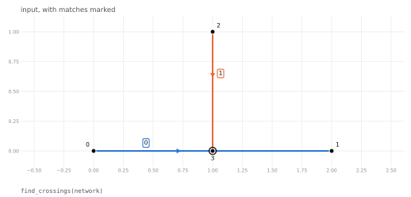

| edge_a | measure_a | edge_b | measure_b | x | y |
| --- | --- | --- | --- | --- | --- |
| 0 | 1 | 1 | 1 | 1 | 0 |

Case file: `conformance/operations/find_crossings/ends-on-middle.json`

#### Edges that meet at a shared node

Edges that meet at a node they share do not cross.

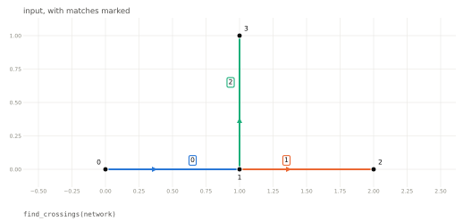

No matches.

Case file: `conformance/operations/find_crossings/shared-node.json`

#### An edge that crosses itself

The edge is both sides of the crossing, at two different distances along itself.

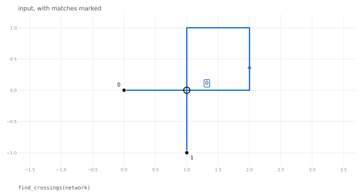

| edge_a | measure_a | edge_b | measure_b | x | y |
| --- | --- | --- | --- | --- | --- |
| 0 | 1 | 0 | 5 | 1 | 0 |

Case file: `conformance/operations/find_crossings/self-crossing.json`

#### Three edges through one point

Each pair of edges is reported: three crossings at the same place.

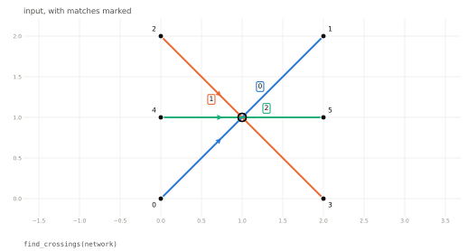

| edge_a | measure_a | edge_b | measure_b | x | y |
| --- | --- | --- | --- | --- | --- |
| 0 | 1.41421 | 1 | 1.41421 | 1 | 1 |
| 0 | 1.41421 | 2 | 1 | 1 | 1 |
| 1 | 1.41421 | 2 | 1 | 1 | 1 |

Case file: `conformance/operations/find_crossings/three-through-one-point.json`

#### Edges that share a stretch of line

Edges that overlap do not cross along the overlap. Only the ends of the shared stretch are reported: where edge 1 starts on edge 0, and where edge 0 ends on edge 1.

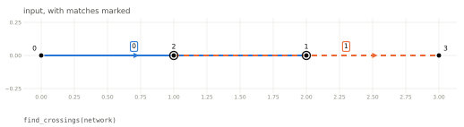

| edge_a | measure_a | edge_b | measure_b | x | y |
| --- | --- | --- | --- | --- | --- |
| 0 | 1 | 1 | 0 | 1 | 0 |
| 0 | 2 | 1 | 1 | 2 | 0 |

Case file: `conformance/operations/find_crossings/shared-stretch.json`

#### A crossing at a vertex of both edges

Two edges that touch at a corner of each meet there once.

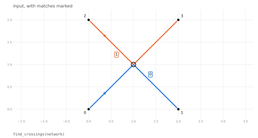

| edge_a | measure_a | edge_b | measure_b | x | y |
| --- | --- | --- | --- | --- | --- |
| 0 | 1.41421 | 1 | 1.41421 | 1 | 1 |

Case file: `conformance/operations/find_crossings/at-a-vertex.json`

### `match_edges`

#### Two edges that run alongside each other for part of their length

Edge 1 runs 0.1 from edge 0, from 4 to 10 along edge 0 and from 0 to 6 along itself.

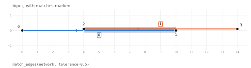

| edge_a | start_a | end_a | edge_b | start_b | end_b | reversed | distance |
| --- | --- | --- | --- | --- | --- | --- | --- |
| 0 | 4 | 10 | 1 | 0 | 6 | false | 0.1 |

Case file: `conformance/operations/match_edges/alongside.json`

#### Edges that run in opposite directions

The same, with edge 1 drawn the other way: its stretch is from 4 to 10 along itself, and reversed is true.

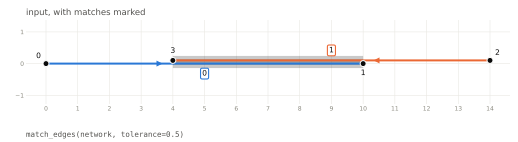

| edge_a | start_a | end_a | edge_b | start_b | end_b | reversed | distance |
| --- | --- | --- | --- | --- | --- | --- | --- |
| 0 | 4 | 10 | 1 | 4 | 10 | true | 0.1 |

Case file: `conformance/operations/match_edges/reversed.json`

#### Opposite directions, directed

With directed=true only edges running the same way match, so there is nothing here.

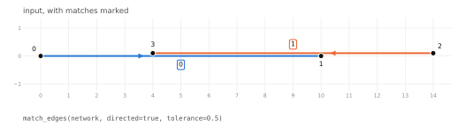

No matches.

Case file: `conformance/operations/match_edges/directed.json`

#### Edges that only cross

Two edges that cross are within tolerance of each other for a short way around the crossing. That stretch is shorter than min_length (by default twice the tolerance), so it is not reported.

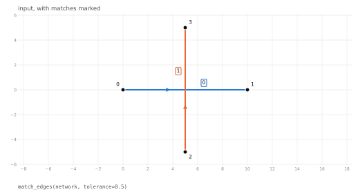

No matches.

Case file: `conformance/operations/match_edges/crossing-only.json`

#### Edges that lie on the same line

With a tolerance of 0, only a stretch that both edges share exactly is matched.

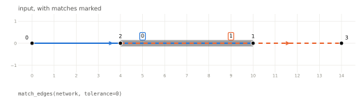

| edge_a | start_a | end_a | edge_b | start_b | end_b | reversed | distance |
| --- | --- | --- | --- | --- | --- | --- | --- |
| 0 | 4 | 10 | 1 | 0 | 6 | false | 0 |

Case file: `conformance/operations/match_edges/exact-overlap.json`

## Nodes close together

Merge them, or keep them and link them.

### `merge_nodes`

#### Two nodes that nearly meet

Nodes 1 and 2 become one node at their centroid, with the id of the first. The ends of both edges move to it.

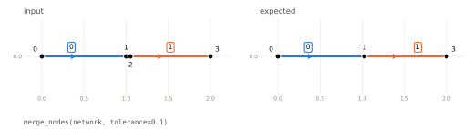

Case file: `conformance/operations/merge_nodes/centroid.json`

#### Merged node at the position of the first

With position="first" the merged node sits where the first of its members was, and only the other moves.

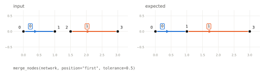

Case file: `conformance/operations/merge_nodes/position-first.json`

#### Edges extended, not moved

With geometry="extend" each edge keeps its line and gains a vertex to reach the merged node.

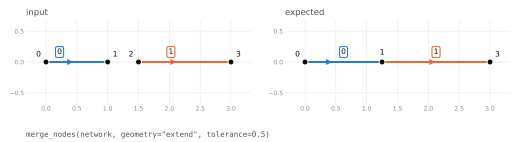

Case file: `conformance/operations/merge_nodes/geometry-extend.json`

#### Nodes merge in chains

The nodes at 1, 1.5 and 2 on the y axis are each within tolerance of the next, so all three merge, although the outer two are further apart than the tolerance.

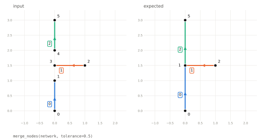

Case file: `conformance/operations/merge_nodes/chain.json`

#### A chain wider than max_spread

The same chain would move its outer nodes by 0.5. With max_spread below that, the merge is refused.

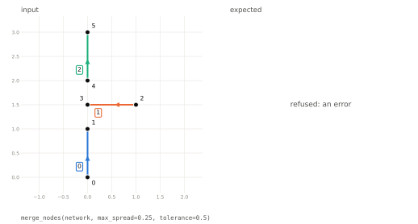

Case file: `conformance/operations/merge_nodes/max-spread.json`

#### A short edge between merged nodes

Edge 1 joins the two nodes that merge and is no longer than the tolerance, so it is dropped.

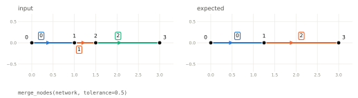

Case file: `conformance/operations/merge_nodes/short-edge-dropped.json`

#### A long edge between merged nodes

Edge 0 joins the two nodes that merge but is longer than the tolerance, so it is kept, as a self-loop.

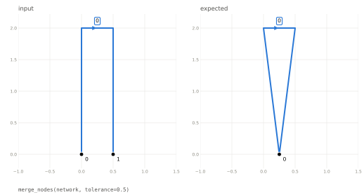

Case file: `conformance/operations/merge_nodes/long-edge-becomes-loop.json`

#### Attributes of merged nodes

By default a merged node keeps a value only where all its members agree: kind is kept, name is null.

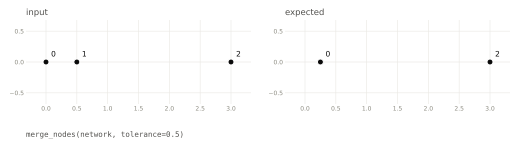

Input nodes:

| id | kind | name |
| --- | --- | --- |
| 0 | stop | A |
| 1 | stop | B |
| 2 | depot | C |

Expected nodes:

| id | kind | name |
| --- | --- | --- |
| 0 | stop |  |
| 2 | depot | C |

Case file: `conformance/operations/merge_nodes/attributes-agree-or-null.json`

#### Attributes of merged nodes, with rules

agg gives a rule for each column: here the first name, the sum of load, and the list of codes.

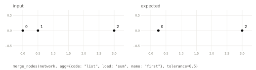

Input nodes:

| id | code | load | name |
| --- | --- | --- | --- |
| 0 | x | 2 | A |
| 1 | y | 3 | B |
| 2 | z | 5 | C |

Expected nodes:

| id | code | load | name |
| --- | --- | --- | --- |
| 0 | x, y | 5 | A |
| 2 | z | 5 | C |

Case file: `conformance/operations/merge_nodes/attributes-agg.json`

#### An empty network

An empty network gives an empty network.

Case file: `conformance/operations/merge_nodes/empty.json`

### `link_nodes`

#### Two nodes that nearly meet

Both nodes are kept and a straight edge is added between them, from the earlier to the later. The new edge has the next id and null attributes.

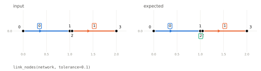

Input edges:

| id | name |
| --- | --- |
| 0 | west |
| 1 | east |

Expected edges:

| id | name |
| --- | --- |
| 0 | west |
| 1 | east |
| 2 |  |

Case file: `conformance/operations/link_nodes/pair.json`

#### Every pair within tolerance

With how="all" (the default) every pair of nodes within tolerance is linked: all three sides of the triangle.

Case file: `conformance/operations/link_nodes/all.json`

#### Each node to its nearest only

With how="nearest" each node is linked to its nearest neighbour within tolerance. Nodes 0 and 1 choose each other and node 2 chooses node 1, so the long side is left out.

Case file: `conformance/operations/link_nodes/nearest.json`

#### Nodes that already share an edge

Nodes 0 and 1 are within tolerance but already have an edge between them, so no edge is added there. Nodes 1 and 2 are linked.

Case file: `conformance/operations/link_nodes/already-linked.json`

#### Nodes at the same place

Nodes at exactly the same place are not linked: the edge would have no length.

Case file: `conformance/operations/link_nodes/same-place.json`

## Splitting and linking

Operations that cut edges, at places given, at nodes, or where edges cross.

### `split_edges`

#### One cut

The edge is cut 1 along. A node is made at the cut, and both pieces get new ids.

Case file: `conformance/operations/split_edges/one-cut.json`

#### Several cuts on one edge

Cuts need not be given in order. The pieces are in order along the edge and take its place in the edges table; the new nodes are numbered in the order the cuts were given.

Case file: `conformance/operations/split_edges/several-cuts.json`

#### A cut at an existing node

A location that names a node puts that node at the cut, and the edge bends to pass through it. No node is created.

Case file: `conformance/operations/split_edges/at-a-named-node.json`

#### A cut on an edge with a corner

The measure runs along the line: 3 along is 1 up the second segment. A cut exactly at a vertex (2 along) does not repeat the vertex.

Case file: `conformance/operations/split_edges/measure-round-a-corner.json`

#### A cut close to an end

A cut within the tolerance of an end of the edge is not made, so no very short edge is created.

Case file: `conformance/operations/split_edges/tolerance-near-end.json`

#### Attributes of the pieces

Pieces copy the attributes of the edge. A column named in extensive is shared out in proportion to length.

Input edges:

| id | cost | name |
| --- | --- | --- |
| 0 | 8 | A1 |

Expected edges:

| id | cost | name |
| --- | --- | --- |
| 1 | 2 | A1 |
| 2 | 6 | A1 |

Case file: `conformance/operations/split_edges/extensive.json`

#### A cut on a self-loop

A loop cut once becomes two edges between its node and the new node.

Case file: `conformance/operations/split_edges/self-loop.json`

### `split_edges_at_nodes`

#### A node close to an edge

The edge is split at the node and bends to pass through it. The node does not move.

Case file: `conformance/operations/split_edges_at_nodes/near-node.json`

#### Moving the node, not the edge

With move="node" the node is moved onto the edge, which keeps its line.

Case file: `conformance/operations/split_edges_at_nodes/move-node.json`

#### A node exactly on an edge

With no tolerance, only a node exactly on the line splits it. Node 3, just off the line, does not.

Case file: `conformance/operations/split_edges_at_nodes/exact.json`

#### A node exactly on a vertex

The edge is split at its corner. The vertex is not repeated.

Case file: `conformance/operations/split_edges_at_nodes/on-a-vertex.json`

#### Several nodes along one edge

The edge is cut at each node, and the pieces are in order along it whatever the order of the nodes.

Case file: `conformance/operations/split_edges_at_nodes/several-nodes.json`

#### A node close to the end of an edge

Node 2 is within tolerance of the edge, but the nearest place on it is its end. That is a node near a node, which is for merge_nodes: the edge is not split.

Case file: `conformance/operations/split_edges_at_nodes/near-an-end.json`

#### The end of one edge on the middle of another

Node 2, the start of edge 1, lies on edge 0. Edge 0 is split there, which connects the two.

Case file: `conformance/operations/split_edges_at_nodes/end-of-another-edge.json`

### `link_nodes_to_edges`

#### A node off the network

The node is projected onto its nearest edge. The edge is split there with a new node, and a new edge joins the node to it. The projected position is shared exactly by all three edges.

Case file: `conformance/operations/link_nodes_to_edges/nearest.json`

#### Every edge within a distance

With how="all" the node is linked to every edge within max_distance: here to both.

Case file: `conformance/operations/link_nodes_to_edges/all-within.json`

#### Nearest, but not too far

Node 2 is within max_distance of the edge and is linked. Node 3 is not, and is left alone.

Case file: `conformance/operations/link_nodes_to_edges/max-distance.json`

#### A node beyond the end of an edge

The nearest place on the edge is its end, so the node is linked to the node already there and the edge is not split.

Case file: `conformance/operations/link_nodes_to_edges/beyond-the-end.json`

#### A projection close to an end

The node projects onto the edge 0.25 from its end. That is within the tolerance, so the node is linked to the end node and no short edge is made.

Case file: `conformance/operations/link_nodes_to_edges/tolerance-near-end.json`

#### Moving the node onto the edge

With link=false the node is moved to the projected position and the edge is split at it. No edge is added.

Case file: `conformance/operations/link_nodes_to_edges/no-link.json`

#### Choosing which nodes to link

By default only nodes with no edges are linked. Here the nodes mask chooses node 3, the loose end of edge 1. It is linked to the nearest edge that it is not already an end of.

Case file: `conformance/operations/link_nodes_to_edges/chosen-nodes.json`

#### Two nodes that project to the same place

Both nodes project onto the edge at the same place, and share one new node there.

Case file: `conformance/operations/link_nodes_to_edges/shared-projection.json`

#### A node already on the edge

A node exactly on the edge needs no linking edge: the edge is split at the node.

Case file: `conformance/operations/link_nodes_to_edges/on-the-edge.json`

#### Attributes of the pieces and of the link

Pieces of the split edge copy its attributes, with the extensive column shared by length. The linking edge is new and has null attributes.

Input edges:

| id | cost | name |
| --- | --- | --- |
| 0 | 8 | A1 |

Expected edges:

| id | cost | name |
| --- | --- | --- |
| 1 | 2 | A1 |
| 2 | 6 | A1 |
| 3 |  |  |

Case file: `conformance/operations/link_nodes_to_edges/extensive.json`

### `split_edges_at_crossings`

#### Two edges that cross

A node is made at the crossing and both edges are split there. All four pieces get new ids.

Case file: `conformance/operations/split_edges_at_crossings/cross.json`

#### An edge that ends on the middle of another

Edge 0 is split at the node where edge 1 ends. No node is created, and edge 1 is unchanged.

Case file: `conformance/operations/split_edges_at_crossings/ends-on-middle.json`

#### A crossing close to an end

Edge 1 crosses edge 0 only 0.25 short of its own end. With a tolerance of 0.5 the crossing uses that end node: edge 0 is split and bent to pass through it, and no short edge is made.

Case file: `conformance/operations/split_edges_at_crossings/tolerance-near-end.json`

#### A crossing close to an end, with no tolerance

The same network with no tolerance: a node is made at the crossing, leaving a short edge beyond it.

Case file: `conformance/operations/split_edges_at_crossings/no-tolerance-near-end.json`

#### Three edges through one point

The three crossings are at the same place and share one new node. Each edge is split in two.

Case file: `conformance/operations/split_edges_at_crossings/three-through-one-point.json`

#### An edge that crosses itself

The edge is cut twice at the crossing, giving three pieces. The middle piece is a loop.

Case file: `conformance/operations/split_edges_at_crossings/self-crossing.json`

#### A crossing at a vertex of both edges

Both edges are split at the corner where they touch. The vertex is not repeated.

Case file: `conformance/operations/split_edges_at_crossings/at-a-vertex.json`

#### Edges that share a stretch of line

Each edge is split where the other ends on it. The shared stretch is left as two edges between the same nodes, which drop_duplicate_edges can then remove.

Case file: `conformance/operations/split_edges_at_crossings/shared-stretch.json`

#### Several crossings on one edge

Edge 0 is crossed twice and becomes three pieces, in order along it.

Case file: `conformance/operations/split_edges_at_crossings/several-on-one-edge.json`

#### Attributes of the pieces

Pieces copy the attributes of their edge. A column named in extensive is shared out in proportion to length.

Input edges:

| id | cost | name |
| --- | --- | --- |
| 0 | 8 | A1 |
| 1 | 3 | B2 |

Expected edges:

| id | cost | name |
| --- | --- | --- |
| 2 | 2 | A1 |
| 3 | 6 | A1 |
| 4 | 1.5 | B2 |
| 5 | 1.5 | B2 |

Case file: `conformance/operations/split_edges_at_crossings/extensive.json`

#### Edges that meet only at nodes

Edges that share a node, parallel edges between the same nodes and a self-loop do not cross: the network is returned unchanged.

Case file: `conformance/operations/split_edges_at_crossings/nothing-to-split.json`

#### A single edge

One straight edge has nothing to cross.

Case file: `conformance/operations/split_edges_at_crossings/single-edge.json`

#### An empty network

An empty network gives an empty network.

Case file: `conformance/operations/split_edges_at_crossings/empty.json`

## Tidying edges

Fewer vertices, fewer edges.

### `simplify_edges`

#### A vertex that hardly matters

The middle vertex is 0.001 off the straight line between the ends, less than the tolerance, so it is removed.

Case file: `conformance/operations/simplify_edges/nearly-straight.json`

#### A vertex that matters

The corner at (2 1) is further than the tolerance from the simplified line and is kept. The vertex at (1 0.5) lies on the simplified line and is removed. The ends never move.

Case file: `conformance/operations/simplify_edges/corner-kept.json`

#### Simplifying must not create a crossing

Removing the bump from edge 0 would make it cross edge 1, which it goes around. So edge 0 keeps its shape.

Case file: `conformance/operations/simplify_edges/no-new-crossing.json`

#### A self-loop

A loop is simplified like any other edge, and stays a loop.

Case file: `conformance/operations/simplify_edges/self-loop.json`

### `merge_edges`

#### Two edges through a node of degree 2

The two edges become one, with a new id, and the node between them is removed. Edge 1 ran the other way and is reversed, so the merged edge runs in the direction of the earliest.

Case file: `conformance/operations/merge_edges/chain.json`

#### Chains stop at junctions

Node 2 has three edges and is kept. The two edges of the chain leading to it are merged; the merged edge takes the place of its earliest member in the table.

Case file: `conformance/operations/merge_edges/junction.json`

#### Only where attributes agree

With by=["kind"] edges are merged only where they have the same kind. Node 1 joins two roads and is removed; node 2 joins a road and a track and is kept.

Input edges:

| id | kind |
| --- | --- |
| 0 | road |
| 1 | road |
| 2 | track |

Expected edges:

| id | kind |
| --- | --- |
| 3 | road |
| 2 | track |

Case file: `conformance/operations/merge_edges/by.json`

#### Keeping chosen nodes

keep is a mask over the nodes table. Node 1 has two edges but is kept, so only the edges through node 2 merge.

Case file: `conformance/operations/merge_edges/keep.json`

#### Respecting direction

With directed=true edges are merged only through a node with one edge in and one out. Node 1 is such a node. At node 2 both edges arrive, so it is kept.

Case file: `conformance/operations/merge_edges/directed.json`

#### Ignoring direction

The same network without directed: all three edges merge, and the last is reversed.

Case file: `conformance/operations/merge_edges/undirected.json`

#### A closed ring

Every node of the ring has two edges. The ring becomes a single self-loop that keeps one node: the start of its earliest edge.

Case file: `conformance/operations/merge_edges/ring.json`

#### A self-loop and parallel edges

Node 0 has degree 2, but both ends belong to one edge, the loop, so nothing is merged through it. The two parallel edges are a ring of two edges and become a loop on node 1.

Case file: `conformance/operations/merge_edges/loops-and-parallel-edges.json`

#### Attributes of a merged edge

By default a merged edge keeps a value only where all its members agree: kind is kept, name and cost are null.

Input edges:

| id | cost | kind | name |
| --- | --- | --- | --- |
| 0 | 2 | road | A1 |
| 1 | 3 | road | B2 |

Expected edges:

| id | cost | kind | name |
| --- | --- | --- | --- |
| 2 |  | road |  |

Case file: `conformance/operations/merge_edges/attributes-agree-or-null.json`

#### Attributes of a merged edge, with rules

agg gives a rule for each column: here the first name, the sum of cost and the largest speed.

Input edges:

| id | cost | name | speed |
| --- | --- | --- | --- |
| 0 | 2 | A1 | 30 |
| 1 | 3 | B2 | 50 |

Expected edges:

| id | cost | name | speed |
| --- | --- | --- | --- |
| 2 | 5 | A1 | 50 |

Case file: `conformance/operations/merge_edges/attributes-agg.json`

#### A single edge

Nothing to merge: the network is returned unchanged.

Case file: `conformance/operations/merge_edges/single-edge.json`

### `drop_duplicate_edges`

#### The same line drawn twice

Edge 1 joins the same nodes as edge 0 along the same line, in the other direction and with an extra vertex. It duplicates edge 0 and is dropped: the earlier edge is the one kept.

Case file: `conformance/operations/drop_duplicate_edges/same-line.json`

#### Opposite directions, directed

With directed=true an edge running the other way is not a duplicate. Edge 2 runs the same way as edge 0 and is dropped.

Case file: `conformance/operations/drop_duplicate_edges/directed.json`

#### Different routes between the same nodes

Edges 0 and 1 join the same nodes but by different lines, so both are kept.

Case file: `conformance/operations/drop_duplicate_edges/parallel-edges-kept.json`

#### Nearly the same line

Edge 1 strays 0.25 from edge 0, within the tolerance, and is dropped. Edge 2 strays 1 and is kept.

Case file: `conformance/operations/drop_duplicate_edges/tolerance.json`

#### The same loop drawn twice

Two loops on one node along the same line, drawn in opposite directions, are duplicates.

Case file: `conformance/operations/drop_duplicate_edges/self-loops.json`

## Connected parts

### `label_components`

#### Two connected parts and an isolated node

Nodes and edges get a component column. Parts are numbered from 0 in order of their first node.

Expected nodes:

| id | component |
| --- | --- |
| 0 | 0 |
| 1 | 0 |
| 2 | 0 |
| 3 | 1 |
| 4 | 1 |
| 5 | 2 |

Expected edges:

| id | component |
| --- | --- |
| 0 | 0 |
| 1 | 0 |
| 2 | 1 |

Case file: `conformance/operations/label_components/two-parts.json`

#### Naming the column

column sets the name of the column added. Edges that cross without a node are not connected.

Expected nodes:

| id | part |
| --- | --- |
| 0 | 0 |
| 1 | 0 |
| 2 | 1 |
| 3 | 1 |

Expected edges:

| id | part |
| --- | --- |
| 0 | 0 |
| 1 | 1 |

Case file: `conformance/operations/label_components/column.json`

#### An empty network

An empty network gives an empty network.

Case file: `conformance/operations/label_components/empty.json`

## Several networks

Each input network has a panel of its own. Edges are matched between networks, never within one.

### `combine`

#### Two networks side by side

The networks are placed in one table, in order, without being connected, even where they touch. The first keeps its ids; ids of the second are shifted to follow on. A source column names the network each feature came from.

Expected nodes:

| id | source |
| --- | --- |
| 0 | rail |
| 1 | rail |
| 2 | road |
| 3 | road |
| 4 | road |

Expected edges:

| id | source |
| --- | --- |
| 0 | rail |
| 1 | road |
| 2 | road |

Case file: `conformance/operations/combine/two-networks.json`

#### Naming the source column, and attributes

column names the column added. An attribute that only one network has is null for the other.

Input `a` edges:

| id | lanes |
| --- | --- |
| 0 | 2 |

Input `b` edges:

| id | gauge |
| --- | --- |
| 0 | narrow |

Expected nodes:

| id | network |
| --- | --- |
| 0 | a |
| 1 | a |
| 2 | b |
| 3 | b |

Expected edges:

| id | gauge | lanes | network |
| --- | --- | --- | --- |
| 0 |  | 2 | a |
| 1 | narrow |  | b |

Case file: `conformance/operations/combine/column.json`

#### No source column

With column=null no column is added. Ids follow on from the highest id before, not from the count.

Case file: `conformance/operations/combine/no-column.json`

### `stitch`

#### Two networks that share a node on the cut

The node at (1 0) is in both networks and becomes one node, with the id it has in the first. Other ids are as for combine.

Expected nodes:

| id | source |
| --- | --- |
| 0 | a_west |
| 1 | a_west |
| 3 | b_east |

Expected edges:

| id | source |
| --- | --- |
| 0 | a_west |
| 1 | b_east |

Case file: `conformance/operations/stitch/shared-node.json`

#### Nodes that nearly meet on the cut

With a tolerance, nodes of different networks that close are one node. It takes the position it has in the first network, and the edge of the second moves to it.

Expected nodes:

| id | source |
| --- | --- |
| 0 | a_west |
| 1 | a_west |
| 3 | b_east |

Expected edges:

| id | source |
| --- | --- |
| 0 | a_west |
| 1 | b_east |

Case file: `conformance/operations/stitch/tolerance.json`

#### Close nodes within one network

Only nodes of different networks are joined. The two nodes of the first network are within tolerance of each other but stay apart.

Expected nodes:

| id | source |
| --- | --- |
| 0 | a_west |
| 1 | a_west |
| 2 | b_east |
| 3 | b_east |

Expected edges:

| id | source |
| --- | --- |
| 0 | a_west |
| 1 | b_east |

Case file: `conformance/operations/stitch/not-within-one-network.json`

#### Matching nodes by id

With on="id" nodes with the same id in different networks are the same node, wherever they are. Node 1 of the second network is node 1 of the first, and its edge moves to the first's position.

Expected nodes:

| id | source |
| --- | --- |
| 0 | a_west |
| 1 | a_west |
| 9 | b_east |

Expected edges:

| id | source |
| --- | --- |
| 0 | a_west |
| 1 | b_east |

Case file: `conformance/operations/stitch/on-id.json`

#### Matching nodes by a column

on names a column: nodes of different networks with the same value in it are the same node. Nodes with a null value are never matched.

Input `a_west` nodes:

| id | code |
| --- | --- |
| 0 |  |
| 1 | X |

Input `b_east` nodes:

| id | code |
| --- | --- |
| 0 | X |
| 1 |  |

Expected nodes:

| id | code |
| --- | --- |
| 0 |  |
| 1 | X |
| 3 |  |

Case file: `conformance/operations/stitch/on-column.json`

### `union`

#### Two networks with an edge in common

The edge from (1 0) to (2 0) is in both and is kept once, as a's. b's other edge is added, with ids shifted to follow a's.

Case file: `conformance/operations/union/shared-edge.json`

#### Nearly the same edge

With a tolerance, b's nodes within reach of a's are the same nodes, at a's positions, and b's first edge is the same as a's second. b's remaining edge is moved to start at a's node.

Case file: `conformance/operations/union/tolerance.json`

#### Nearly the same edge, with no tolerance

With no tolerance nothing matches, and the union is both networks side by side.

Case file: `conformance/operations/union/no-tolerance.json`

#### Edges that partly overlap

With split=true each edge is first split where the other starts or stops running alongside it. The shared stretch is kept once with a's geometry; b's remainder is joined to a's end node.

Case file: `conformance/operations/union/split.json`

#### Attributes and isolated nodes

A shared edge keeps a's attributes and direction. An isolated node in both is kept once.

Input `a` edges:

| id | name |
| --- | --- |
| 0 | a's |

Input `b` edges:

| id | name |
| --- | --- |
| 0 | b's |

Expected edges:

| id | name |
| --- | --- |
| 0 | a's |

Case file: `conformance/operations/union/attributes-and-isolated-nodes.json`

### `intersection`

#### Two networks with an edge in common

Only a's edge that is also in b is kept, with its end nodes.

Case file: `conformance/operations/intersection/shared-edge.json`

#### Nearly the same edge

With a tolerance, a's second edge matches b's first, and is kept at a's position.

Case file: `conformance/operations/intersection/tolerance.json`

#### Edges that partly overlap

With split=true, the stretch of a that b runs alongside.

Case file: `conformance/operations/intersection/split.json`

#### Attributes and isolated nodes

The shared edge has a's attributes. Of a's isolated nodes, the one that is also in b is kept.

Input `a` edges:

| id | name |
| --- | --- |
| 0 | a's |

Input `b` edges:

| id | name |
| --- | --- |
| 0 | b's |

Expected edges:

| id | name |
| --- | --- |
| 0 | a's |

Case file: `conformance/operations/intersection/attributes-and-isolated-nodes.json`

#### Nothing in common

Networks that only touch at a node share no edge, and the node is used by an edge of a, so it is not an isolated node in common either: the result is empty.

Case file: `conformance/operations/intersection/nothing-shared.json`

### `difference`

#### Two networks with an edge in common

Only a's edge that is not in b is kept, with its end nodes.

Case file: `conformance/operations/difference/shared-edge.json`

#### Nearly the same edge

With a tolerance, a's second edge matches b's first and is removed.

Case file: `conformance/operations/difference/tolerance.json`

#### Edges that partly overlap

With split=true, the stretch of a that b does not run alongside.

Case file: `conformance/operations/difference/split.json`

#### Attributes and isolated nodes

a's only edge is in b, so no edge is left. Of a's isolated nodes, the one that is not in b is kept.

Input `a` edges:

| id | name |
| --- | --- |
| 0 | a's |

Input `b` edges:

| id | name |
| --- | --- |
| 0 | b's |

Case file: `conformance/operations/difference/attributes-and-isolated-nodes.json`

## Kernel cases

A second set of cases, in `conformance/kernel`, pins down the functions of the array kernel
on plain arrays. They have no figures. `conformance/README.md` sets out the format of both
sets.
